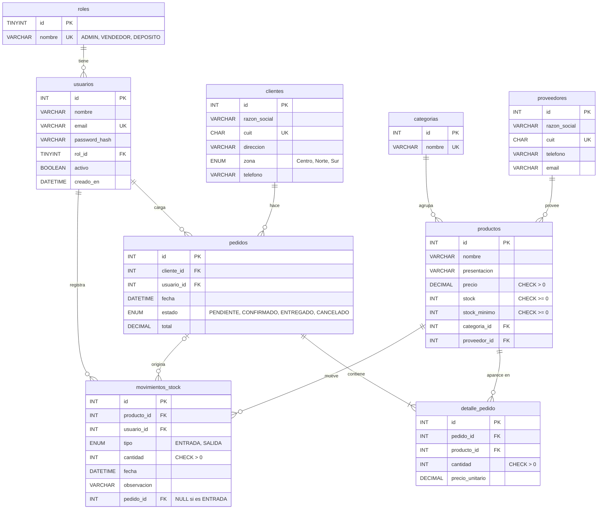

# Modelo entidad-relación

Base de datos: `distribuidora` (MySQL 8, motor InnoDB, `utf8mb4`).

## Restricciones que hay que mostrar en la defensa

| Restricción | Dónde | Para qué |
|---|---|---|
| `CHECK (stock >= 0)` | productos | La base nunca acepta stock negativo, aunque falle el backend |
| `CHECK (cantidad > 0)` | detalle_pedido, movimientos_stock | No hay líneas ni movimientos en cero |
| `CHECK (precio > 0)` | productos | |
| `UNIQUE (email)` | usuarios | |
| `UNIQUE (cuit)` | proveedores, clientes | |
| `UNIQUE (pedido_id, producto_id)` | detalle_pedido | Un producto aparece una sola vez por pedido |
| `ON DELETE RESTRICT` | todas las FK, salvo la de abajo | No se puede borrar un producto, cliente o categoría con historial |
| `ON DELETE CASCADE` | detalle_pedido.pedido_id | Si se borra un pedido pendiente, se van sus líneas |

## Normalización

- **1FN:** todos los campos son atómicos; las líneas del pedido van en `detalle_pedido`, no en una lista dentro de `pedidos`.
- **2FN:** en `detalle_pedido` cada campo depende de la línea completa, no solo del pedido o del producto.
- **3FN:** el nombre de la categoría o del proveedor no se repite en `productos`; se guarda solo su id.
- **Excepción a propósito:** `detalle_pedido.precio_unitario` copia el precio del producto al momento de la venta. Si mañana sube el precio, los pedidos viejos tienen que seguir mostrando lo que se cobró. Conviene explicarlo en la defensa, porque parece una redundancia y no lo es.
- **`pedidos.total`** también es un valor calculado que se guarda al confirmar, por el mismo motivo: queda congelado.

## Procedimiento almacenado

`sp_confirmar_pedido(IN p_pedido_id INT, IN p_usuario_id INT)`

1. `START TRANSACTION`.
2. Bloquea el pedido y verifica que esté `PENDIENTE` y tenga líneas; si no, `ROLLBACK` y `SIGNAL` con el error.
3. Bloquea los productos del pedido (`SELECT ... FOR UPDATE`) y verifica el stock de cada línea; si alguno no alcanza, `ROLLBACK` y `SIGNAL SQLSTATE '45000'` con el nombre del producto.
4. Descuenta el stock, inserta un movimiento `SALIDA` por línea, calcula el total y pasa el pedido a `CONFIRMADO`.
5. `COMMIT`.
6. Un `DECLARE EXIT HANDLER FOR SQLEXCEPTION` hace `ROLLBACK` y relanza el error ante cualquier falla inesperada.

El backend traduce el `SIGNAL` de falta de stock a un `409 STOCK_INSUFICIENTE` (ver `contrato-api.md`).
